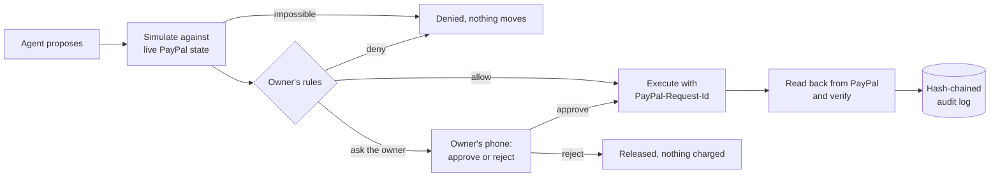
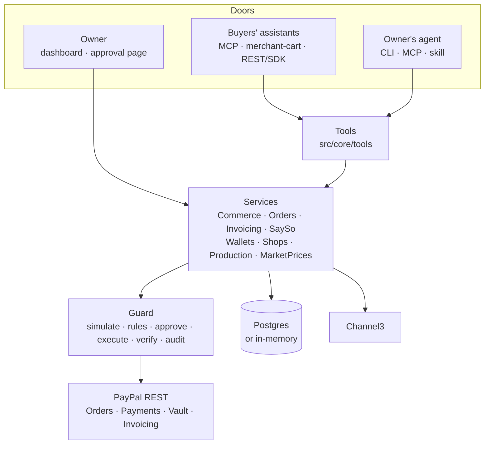

# Sayso

**Small shops for AI shoppers, run by the owner's own AI agent. No money moves without the owner's say-so.**

Sayso turns a few photos and a price list into a shop that any AI shopping assistant can buy from through PayPal. The owner signs in with PayPal and is paid straight into their own PayPal account. Their own agent runs the shop day to day through a CLI, MCP tools and an agent skill. Every refund, capture, invoice and rule change passes through **Guard**: it is simulated against live PayPal state, checked against the owner's rules, sent to the owner's phone when it needs their OK, executed idempotently and read back from PayPal before it counts. And when the owner keeps saying yes to the same thing, Sayso suggests letting the agent do it alone: **autonomy is earned, never grabbed.**

Built for the [PayPal AI Hackathon](https://paypalaihackathon.devpost.com/) (2026). Runs on the PayPal **sandbox**; no real money moves.

| | |
|---|---|
| **Live demo** | [sayso-ovph.onrender.com](https://sayso-ovph.onrender.com) (start with **[For Judges: the 2-minute tour](https://sayso-ovph.onrender.com/tour)**) |
| **Demo video** | _added before submission_ |
| **Developer portal** | [/developers](https://sayso-ovph.onrender.com/developers/) (generated by APIMatic) |
| **Shopping MCP for any assistant** | `https://sayso-ovph.onrender.com/api/shopping/mcp` |
| **For agents that browse** | [/llms.txt](https://sayso-ovph.onrender.com/llms.txt), and schema.org JSON-LD on every shop page |

---

## The problem

AI assistants are becoming a place where people shop. PayPal's agentic commerce services already reach the big assistants, but a store gets there through a commerce platform or a protocol integration. The one-person businesses that sell through Instagram DMs, markets or a PayPal button have neither.

Once agents buy and sell, someone also has to run the shop: answer "where's my order", refund the chipped mug, add tracking, invoice a commission, restock. The seller's own AI agent could do all of that today, **if it could be trusted with the money**. Sayso is the missing piece: a shop agents can buy from, and a say-so layer that keeps every money movement inside the owner's rules.

## What it does

| Who | How they connect | What they can do |
|---|---|---|
| **Buyers' assistants** (ChatGPT or any MCP client, PayPal's commerce platform) | One public MCP URL for every shop, PayPal's **Agentic Commerce merchant-cart API**, or REST with the generated SDKs. They find shops on their own through `/llms.txt`, the sitemap and schema.org markup | Search shops, build a cart with exact prices, shipping and tax, fix stock problems on their own, pay in PayPal, follow the order, ask for a refund. Optionally pay with **saved PayPal** inside limits the buyer chose |
| **The seller's own agent** | The `sayso` CLI, a seller MCP endpoint (works as a ChatGPT connector), an agent skill | Orders, refunds, tracking, prices and stock, market prices, invoices for custom orders, the made-to-order schedule, propose new rules. It holds a scoped key, never PayPal credentials, and can never approve anything |
| **The owner** | **Sign in with PayPal** (no password to keep), a web dashboard and a phone-first approval page | Get paid straight into their own PayPal, approve or reject what's waiting, adopt rules their own approvals earned, edit the catalog, plan made-to-order work, publish, manage agent keys, read the tamper-evident audit log |

## Guard: the say-so layer

Every money-moving action, from any agent, takes the same path:



- **Rules decide, not the model.** The owner writes rules in plain words ("refunds over $30 need my OK; invoices to new clients always need my OK"). The LLM drafts declarative rules, code validates them, and a deterministic evaluator applies them.
- **Agents can't approve, and can't loosen their own rules.** Approving needs the owner's signed session; no tool or CLI command approves. A rule change is itself a Guard action that always waits for the owner when an agent proposes it.
- **Built-in protections no policy can turn off.** A repeat of the same money movement within minutes is refused, a refund asked by a buyer's assistant always goes to the owner, and an amount left out ("refund everything") is judged at what it would really move.
- **Simulated first, verified after.** A refund larger than what's still refundable, or a capture on an expired hold, is refused before PayPal is called. After a call succeeds, the result is read back from PayPal; if that read fails, the record says "unconfirmed", never "not charged".
- **Authorize, then capture.** The buyer approves in PayPal; Sayso re-checks stock, places an authorization, takes the stock atomically and captures through the shop's Guard. If the order can't go through (sold out, rejected, PayPal refuses), the hold is voided and the stock comes back.
- **Tamper-evident.** Each record's events form a SHA-256 hash chain over canonical JSON, re-checked whenever the log is shown.

## Earned autonomy

Guard keeps every say-so the owner gives. When they have approved three requests of the same kind that a rule held (say refunds of $55, $60 and $72), Sayso suggests a new limit: *"Let your agent handle refunds up to $80.00 on its own"*, with the decisions behind it.

- It only suggests limits the owner's own approvals support, never past anything they turned down, and only from the last 30 days.
- The owner adopts it with one click. The agent can ask for it (`rule_suggestions`, `propose_rule_suggestion`, `sayso policy earned`), but like any rule change from an agent it waits for the owner.
- Other rules keep applying: a refund the new limit allows can still be held by the daily total.
- The Rules page shows how far each rule is from a suggestion, so the owner sees Sayso learning from them.

Agents can't loosen their own rules (step 3 of the tour); they earn it, one decision at a time. Deterministic and explainable on purpose: no model decides how much autonomy an agent gets.

## Sellers sign in with PayPal and are paid directly

- **Sign in with PayPal.** The browser that drafts a shop claims it through Log in with PayPal (a signed, hour-long claim), and the owner signs back in the same way. The OAuth `state` is tied to the browser, codes work once, and a shop that is someone else's or a judge's tour copy can't be claimed. Deployments without PayPal sign-in fall back to an owner secret.
- **Paid straight into their own PayPal.** The owner connects their account through PayPal's partner onboarding (Partner Referrals) and allows Sayso to take payments and refund them, nothing else. Sayso then asks PayPal, not the browser, which account connected and what it allowed. Every new order names the owner as `payee`, so Sayso never holds their money. Guard still authorizes and captures, and refunds of those sales are made from the owner's account, acting for them with `PayPal-Auth-Assertion`. The PayPal order decides which account refunds, so sales from before they connected still refund from where they were paid.
- The demo shop's shared session and judges' tour copies are paid into Sayso's sandbox account, so anyone can try a shop without setting anything up. Invoices for custom orders come from Sayso's account: PayPal only lets approved partners invoice for a seller.

## For Judges: the 2-minute tour

Open `https://<host>/tour` (or **For Judges** in the header). No sign-in, nothing to install: it makes you a private copy of the demo shop and signs you in as its owner. Four buttons run scripted agents through the same tools any assistant uses, against the real PayPal sandbox:

1. **A shopping assistant buys.** It asks for two mugs when one is left, applies the shop's fix from the merchant-cart spec, and pays with saved PayPal inside the buyer's limits; the shop's Guard captures.
2. **Your agent asks for a big refund.** Over the $50 rule, so Guard holds it and you decide. PayPal refunds and Sayso reads it back.
3. **Your agent tries to loosen its own rules.** Guard holds it: only the owner can change the rules.
4. **Your agent invoices a commission.** A PayPal invoice to a new client waits for you, then lands on the Making board, blocked until paid.

Each step shows what the agent did and the Guard record it produced, step by step, with its audit hash. Your copy expires after a day and nobody else sees it. Approve a few refunds in it and the **Rules** page starts suggesting what your agent could do alone.

## Try it in five minutes, your way

The demo shop is **Maya Ceramics**, a one-person studio selling mugs, bowls and made-to-order vases. Pay with a PayPal sandbox **personal** account.

1. **Shop as a buyer's assistant.** Add `https://<host>/api/shopping/mcp` as a connector in ChatGPT or any MCP client and ask it to buy two speckled mugs. There's only one in stock: the cart comes back with resolution options the assistant applies on its own, then a PayPal link.
2. **Be the owner.** Open `https://<host>/owner` and press **Open the demo shop**. The order is there; the catalog is an editable grid; **Making** shows made-to-order work gated by PayPal payments.
3. **Run the shop as the owner's agent.**
   ```bash
   node cli/sayso.ts login --url https://<host> --key <demo agent key from the testing instructions>
   node cli/sayso.ts status
   node cli/sayso.ts refund <order> --reason "Arrived broken"   # over the $50 rule: waits for the owner (exit code 3)
   ```
   Approve it on the owner page; `sayso check <id>` flips to done.
4. **Open your own shop** at `https://<host>/start`: paste a price list or add photos. Sayso drafts the catalog and asks about anything it couldn't tell (it never invents prices or stock). Claim it with **Continue with PayPal** (a sandbox business account), publish, then **Connect your PayPal** on the overview: from then on every sale lands in that account. Your agent's key is shown once.

## How it uses PayPal

| PayPal | Used for |
|---|---|
| **Agentic Commerce merchant-cart API v1** | `POST/PUT/GET /merchant-cart` and `/checkout` per shop, with validation issues and resolution options an agent can apply |
| **Orders v2** | `intent: AUTHORIZE` orders from priced carts, buyer approval, authorization, shipment tracking |
| **Payments v2** | Capture and void authorizations, refunds, captures and refunds read back to verify |
| **Partner Referrals + multiparty** | Owners connect their own PayPal; orders carry them as `payee`; refunds of their sales use `PayPal-Auth-Assertion` with the permissions they granted, checked with PayPal before Sayso relies on them |
| **Log in with PayPal** | Owners sign in with PayPal (OpenID Connect: code exchange, userinfo with payer id and verification), no Sayso password |
| **Payment Method Tokens (Vault v3)** | Saved PayPal for a buyer's assistant: setup token, buyer approval with their limits, payment token, deleted on disconnect |
| **Invoicing v2** | Invoices for custom orders with an optional deposit, sent through Guard; live status drives the made-to-order board |
| **Catalog Products** | Products registered when a shop is published |
| **Idempotency** | A deterministic `PayPal-Request-Id` on every write (`<cart>-capture`, `<cart>-void`...), so retries replay instead of repeating |

## How it uses AI

- **Onboarding from photos.** A vision model reads product photos and notes into a draft catalog, and asks the owner about anything it can't see instead of guessing.
- **Rules in plain words.** The owner's sentences become declarative Guard rules; whatever the model couldn't express is shown back, never silently dropped.
- **Agents on both sides.** Any assistant can shop through MCP; the owner's own agent runs the shop through the CLI, MCP and the skill.
- **Guardrails on the model itself.** Output is validated in code, and a daily budget caps what the server can spend (`gpt-4.1-mini` by default; DeepSeek works through the same client). The model never decides whether money moves.

## Partner tools

| Tool | Where | Why it's there |
|---|---|---|
| **AG Grid** | Orders, Activity and Catalog in the owner area | The catalog is edited in place: double-click a price or stock count, Enter saves through the same service as the agent's `update_variant` tool, a refused edit snaps back with the reason, Ctrl+Z undoes. Market prices show per row |
| **Bryntum Scheduler** | **Making** in the owner area | One row per made-to-order piece or commission. The payment bar comes from PayPal and leads into the making bar, which stays blocked until the buyer pays (or pays the deposit). The owner drags to plan; their agent can do the same with `plan_job` |
| **Channel3** | Catalog grid, `price_check` tool, `sayso market` | What similar items sell for at other stores: the usual range (middle half of in-stock listings) and the median, so a small seller can price with confidence. Read-only and cached |
| **APIMatic** | `sdk/`, `/developers`, `examples/sdk-checkout` | Typed TypeScript and Python SDKs and a developer portal (reference, try-it console, guides) generated from [`public/openapi.yaml`](public/openapi.yaml). The example buys through the SDK against a live server |
| **Render** | [`render.yaml`](render.yaml) | Blueprint: web service with a health check, Postgres, and a cron job that cleans up expired tour copies over the private network. The live demo runs on it |

## The `sayso` CLI and agent skill

No dependencies: Node 22.18+ runs `node cli/sayso.ts` directly (or `npm run cli:build`). `--json` on any command gives machine-readable output, and exit codes let an agent branch without parsing text: `0` ok, `1` error, `2` usage, **`3` waiting for the owner**, **`4` refused**.

| Command | What it does |
|---|---|
| `sayso init [photos...] --text "..."` | Draft a new shop from photos and notes |
| `sayso login --key sk_agent_... --url ...` | Sign this machine in with an agent key |
| `sayso status` | Orders, what's waiting for the owner, low stock, what buyers couldn't get |
| `sayso products` · `price <variant> <amount>` · `stock <variant> <qty>` · `market <variant>` | Catalog and market prices |
| `sayso orders` · `order <id>` · `refund <order> [amount] --reason "..."` · `track <order> <carrier> <number>` | Orders |
| `sayso invoice <email> "<item>" <price> --deposit 31.00 --make-days 12` · `invoices` | Custom orders through PayPal invoices |
| `sayso making` · `making plan <job> <start> <end>` | Made-to-order work and its schedule |
| `sayso approvals` · `check <id>` · `policy [propose "..."]` · `policy earned [ask <id>]` · `audit` | Say-so requests, rules, rules the owner's approvals earned, and the audit log (read-only) |
| `sayso tools` · `call <tool> '<json>'` · `mcp` | Any tool raw, or serve the seller tools over stdio |

The skill in [`skills/sayso/SKILL.md`](skills/sayso/SKILL.md) teaches an agent to drive the CLI: always `--json`, start with `status`, never retry a refused action, tell the owner plainly what is waiting.

## MCP endpoints

| Endpoint | Auth | Tools |
|---|---|---|
| `POST /api/shopping/mcp` | none | Every published shop: `list_shops`, `search_products`, `create_cart`, `update_cart`, `get_cart`, `request_refund`, `connect_paypal`, `wallet_status`, `pay_with_paypal` |
| `POST /api/shops/<slug>/mcp` | none | One shop's buyer tools |
| `POST /api/mcp` | `Bearer sk_agent_...` | `shop_overview`, `list_products`, `update_variant`, `price_check`, `production_board`, `plan_job`, `list_orders`, `get_order`, `refund_order`, `add_tracking`, `send_invoice`, `list_invoices`, `list_approvals`, `get_say_so`, `get_policy`, `propose_policy`, `rule_suggestions`, `propose_rule_suggestion`, `audit_log` |

Streamable HTTP with stateless JSON responses (protocol `2025-11-25`, `2025-06-18`, `2025-03-26`). Connector screens that take only a URL get a **personal URL** with the key in the path: `/api/mcp/<sk_agent_...>` for the owner's agent, `/api/shopping/mcp/<sk_wallet_...>` for a buyer with saved PayPal. Revoking the key kills the URL.

**Saved PayPal.** The assistant calls `connect_paypal`; the buyer picks a per-order and a daily limit on Sayso's page and approves once in PayPal. After that `pay_with_paypal` goes through the **buyer's own Guard**: inside the limits PayPal authorizes at once and the shop's Guard captures as usual; over a limit nothing is charged and the buyer gets a normal approval link for that one order. In this demo every shop is paid into one sandbox merchant account; with shops on their own PayPal accounts this would use PayPal's multiparty vaulting.

## Architecture



`src/core` has no framework dependency and is tested end to end against an in-memory PayPal fake that refuses impossible calls the way PayPal does. The Next.js app (`src/app`, `src/server`) is a thin layer over it; tools are defined once and shared by MCP, the CLI and the web app.

```
src/core/guard/        Rules, the Guard pipeline, hash-chained audit, rule changes as actions
src/core/commerce.ts   Carts and checkout: authorize, take stock, capture through Guard, release on failure
src/core/orders.ts     A shop's orders: refunds (through Guard), tracking, missed demand
src/core/invoicing.ts  Invoices for custom orders, live status from PayPal
src/core/production.ts The made-to-order board: jobs, payment state, plans
src/core/market.ts     Market price references (Channel3 in src/core/channel3.ts)
src/core/say-so.ts     What waits for the owner, the audit trail, the rules
src/core/wallets.ts    Saved PayPal for a buyer's assistant, inside the buyer's own limits
src/core/paypal/       REST client (idempotency, retries, timeouts), API calls, Guard executors
src/core/ai/           LLM client, catalog drafting, rule drafting (all output validated)
src/core/tools/        Buyer and seller tools
src/server/            Wiring, Postgres stores, MCP transport, owner notifications
cli/  skills/          The CLI and the agent skill
public/openapi.yaml    The REST API; apimatic/ holds the portal pages, sdk/ the generated SDKs
tests/                 Unit and end-to-end tests (see tests/money-safety.test.ts)
```

## Security

- **Secrets stay on the server.** PayPal, AI and Channel3 keys are read only by server code; nothing is exposed with `NEXT_PUBLIC_` or passed to client components. Agent, owner and wallet secrets are stored as SHA-256 hashes and shown once.
- **Separate credentials, least privilege.** Agent keys run the shop through tools but can't approve, publish or change rules. The owner's session is a signed, expiring, httpOnly cookie, and cookie-authenticated changes refuse cross-site requests.
- **Every route is scoped.** A key or session only reaches its own shop; a shop's endpoint only sees its own carts; buyers' views never include other buyers or internal ids.
- **Trust comes from PayPal.** "Has this person paid me before" and refund recipients use the payer PayPal reports, never an email typed into a cart. Who signed in and which account a shop is paid into come from PayPal's APIs, never from the query strings PayPal redirects with.
- **Sign-in can't be replayed or redirected.** Log in with PayPal checks an OAuth `state` bound to the browser, each code works once, claims and seller sessions are signed tokens bound to their purpose, and the page to land on afterwards is a path on Sayso only.
- **Keys die for good.** Disconnecting saved PayPal retires every key and personal URL issued for it, so a leaked one can't spend again after a reconnect.
- **The public demo is shared, so it's masked.** The demo owner session sees buyers' emails masked and their town instead of their street; phone pushes carry the kind of request and a link, never buyer details.
- **Abuse limits.** Onboarding is limited per address, rule drafting and market searches per shop, and all AI calls share a daily budget; market results are cached.

## Run it locally

Requires Node.js 22.18+ and a PayPal sandbox REST app ([developer.paypal.com](https://developer.paypal.com/dashboard/applications/sandbox)). Paying owners directly needs that app to be of type **Platform**; Log in with PayPal needs an `https` return URL, so it is tried on a deployment (locally, owners use the owner secret).

```bash
npm install
cp .env.example .env.local   # PayPal sandbox keys, an OpenAI key; Channel3 is optional
npm test                     # no network needed
npm run dev                  # http://localhost:3000
```

Then `node cli/sayso.ts login --url http://localhost:3000 --key <SAYSO_DEMO_AGENT_KEY>`, and open `/owner`. Without `DATABASE_URL` everything is kept in memory. `node scripts/try-cart.ts` plays a buyer agent against the merchant-cart API.

APIMatic outputs are rebuilt with `npm run apimatic -- sdk` and `npm run apimatic -- portal` (APIMatic CLI, signed in). [`examples/sdk-checkout`](examples/sdk-checkout) buys through the TypeScript SDK.

## Deploy

[`render.yaml`](render.yaml) is a Render Blueprint: the Node web service (health check `/api/health`), its Postgres, and an hourly cron job that cleans up expired tour copies over Render's private network. Render generates `SAYSO_SECRET` and `SAYSO_CRON_SECRET`; set the PayPal, AI, Channel3 and APIMatic keys, `PUBLIC_BASE_URL` and the demo credentials in the dashboard. For PayPal sign-in and direct payouts, use a Platform app with Log in with PayPal returning to `<PUBLIC_BASE_URL>/api/owner/paypal/callback`, and set `PAYPAL_PARTNER_MERCHANT_ID` to its business account's merchant id. The build generates the developer portal for the deployment's own address when an APIMatic key is set.

## License

[MIT](LICENSE). The *Making* board uses Bryntum Scheduler under the trial Bryntum offers hackathon participants; that package is covered by Bryntum's license, not MIT. Maya Ceramics is a made-up demo shop; its photos in `public/photos` are AI-generated.
