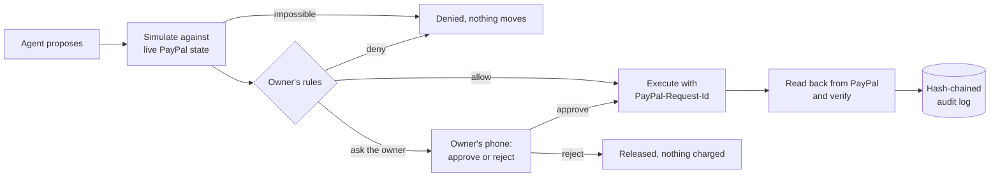
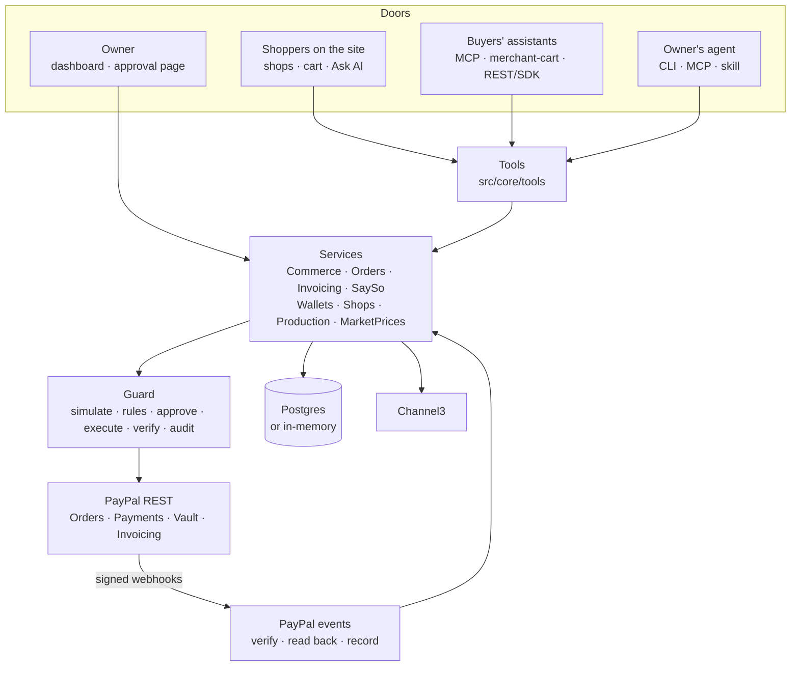

# Sayso

**Small shops for AI shoppers, run by the owner's own AI agent. No money moves without the owner's say-so.**

Sayso turns a few photos and a price list into a shop that any AI shopping assistant can buy from through PayPal. The owner signs in with PayPal and is paid straight into their own PayPal account. Their own agent runs the shop day to day through a CLI, MCP tools and an agent skill. Every refund, capture, invoice and rule change passes through **Guard**: it is simulated against live PayPal state, checked against the owner's rules, sent to the owner's phone when it needs their OK, executed idempotently and read back from PayPal before it counts. PayPal's webhooks keep Sayso in step with what happens in PayPal itself. And when the owner keeps saying yes to the same thing, Sayso suggests letting the agent do it alone: **autonomy is earned, never grabbed.**

Built for the [PayPal AI Hackathon](https://paypalaihackathon.devpost.com/) (2026). Runs on the PayPal **sandbox**; no real money moves.

### In 30 seconds

- **The problem:** one-person shops can't sell to AI shoppers, and no owner should hand an AI agent their PayPal login.
- **Who it's for:** small makers who sell through DMs, markets or a PayPal button, and the AI assistants their buyers use.
- **What it does:** any assistant (ChatGPT, Claude, any MCP client) buys from the shop and pays with PayPal; the owner's own agent runs the shop; **Guard** holds every money move past the owner's rules until they approve, with a passkey if they set one up.
- **PayPal:** Orders v2, Payments, Vault, Invoicing, Partner Referrals, Log in with PayPal and webhooks, plus PayPal's merchant-cart spec. [Details](#how-it-uses-paypal).
- **AI:** a vision model drafts the shop from photos, plain-word rules become exact rules, two assistants (one for shoppers, one read-only for the owner), and MCP for any outside agent. The model never decides whether money moves. [Details](#how-it-uses-ai).
- **Try it in 2 minutes:** [For Judges](https://sayso-ovph.onrender.com/tour), or add `https://sayso-ovph.onrender.com/api/shopping/mcp` to ChatGPT ([how](#add-sayso-to-chatgpt)).

| | |
|---|---|
| **Live demo** | [sayso-ovph.onrender.com](https://sayso-ovph.onrender.com) (start with **[For Judges: try it for real](https://sayso-ovph.onrender.com/tour)**) |
| **Demo video** | [Watch on YouTube](https://www.youtube.com/watch?v=9Up22gN5yS0) (2:36) |
| **Developer portal** | [/developers](https://sayso-ovph.onrender.com/developers/) (generated by APIMatic) |
| **Shopping MCP for any assistant** | `https://sayso-ovph.onrender.com/api/shopping/mcp` |
| **For agents that browse** | [/llms.txt](https://sayso-ovph.onrender.com/llms.txt), and schema.org JSON-LD on every shop and product page |

---

## The problem

AI assistants are becoming a place where people shop. PayPal's agentic commerce services already reach the big assistants, but a store gets there through a commerce platform or a protocol integration. The one-person businesses that sell through Instagram DMs, markets or a PayPal button have neither.

Once agents buy and sell, someone also has to run the shop: answer "where's my order", refund the chipped mug, add tracking, invoice a commission, restock. The seller's own AI agent could do all of that today, **if it could be trusted with the money**. Sayso is the missing piece: a shop agents can buy from, and a say-so layer that keeps every money movement inside the owner's rules.

## What it does

| Who | How they connect | What they can do |
|---|---|---|
| **Shoppers on the site** | **Shops** (every shop and its pieces), a cart per shop, and **Ask AI to shop**, a side panel on every page | Browse, add to a cart and pay with PayPal's own button, or ask Sayso's assistant, which searches every shop, shows products with photos and builds the cart. A cart can be cancelled before paying. Every paid order gets its own page (paid, preparing, shipped with tracking, refunds; **Ask for a refund** hands the order to the assistant, which asks what happened and takes it to the shop), the panel's **Orders** tab lists them on every page (quick views for in progress, shipped, refunds and cancelled, a few at a time), and **My orders** shows every order from any browser once the buyer signs in with the PayPal account they paid with: no Sayso account, PayPal is the identity. On wide screens the panel sits beside the page without resizing it and stays open from page to page |
| **Buyers' assistants** (ChatGPT, Claude or any MCP client, and platforms that speak PayPal's merchant-cart API) | One public MCP URL for every shop, PayPal's **Agentic Commerce merchant-cart API**, or REST with the generated SDKs. They find shops on their own through `/llms.txt`, the sitemap and schema.org markup | Search shops, build a cart with exact prices, shipping and tax, fix stock problems on their own, pay in PayPal, follow the order, ask for a refund. Optionally pay with **saved PayPal** inside limits the buyer chose |
| **The seller's own agent** | The `sayso` CLI, a seller MCP endpoint (ChatGPT, Claude or any MCP app), an agent skill | Orders, refunds, tracking, prices and stock, market prices, invoices for custom orders, the made-to-order schedule, propose new rules. It holds a scoped key, never PayPal credentials, and can never approve anything |
| **The owner** | **Sign in with PayPal** (no password to keep), a web dashboard and a phone-first approval page | See the week at a glance (sales against the week before, what the agents did with the money, where orders came from), get paid straight into their own PayPal, approve or reject what's waiting, adopt rules their own approvals earned, edit the catalog, plan made-to-order work, publish, manage agent keys, read the tamper-evident audit log |

## Guard: the say-so layer

Every money-moving action, from any agent, takes the same path:



- **Rules decide, not the model.** The owner writes rules in plain words ("refunds over $30 need my OK; invoices to new clients always need my OK"). The LLM drafts declarative rules, code validates them, and a deterministic evaluator applies them.
- **Agents can't approve, and can't loosen their own rules.** Approving needs the owner's signed session; no tool or CLI command approves. A rule change is itself a Guard action that always waits for the owner when an agent proposes it.
- **Built-in protections no policy can turn off.** A repeat of the same money movement within minutes is refused, a refund asked by a buyer's assistant always goes to the owner, and an amount left out ("refund everything") is judged at what it would really move.
- **Simulated first, verified after.** A refund larger than what's still refundable, or a capture on an expired hold, is refused before PayPal is called. After a call succeeds, the result is read back from PayPal; if that read fails, the record says "unconfirmed", never "not charged".
- **Authorize, then capture.** The buyer approves in PayPal; Sayso re-checks stock, places an authorization, takes the stock atomically and captures through the shop's Guard. If the order can't go through (sold out, rejected, PayPal refuses), the hold is voided and the stock comes back.
- **Tamper-evident.** Each record's events form a SHA-256 hash chain over canonical JSON, re-checked whenever the log is shown.
- **In step with PayPal.** Money can also move in PayPal itself: the owner refunds from their PayPal account, PayPal reverses a payment, a hold is voided, a buyer opens a dispute. PayPal's webhooks tell Sayso, which verifies the signature, reads the payment back from PayPal and records what changed as a verified "Done in PayPal" entry in the same audit trail. Disputes show on the order and on Overview with their deadline; the owner answers them in PayPal's Resolution Center.

## Earned autonomy

Guard keeps every say-so the owner gives. When they have approved three requests of the same kind that a rule held (say refunds of $55, $60 and $72), Sayso suggests a new limit: *"Let your agent handle refunds up to $80.00 on its own"*, with the decisions behind it.

- It only suggests limits the owner's own approvals support, never past anything they turned down, and only from the last 30 days.
- The owner adopts it with one click. The agent can ask for it (`rule_suggestions`, `propose_rule_suggestion`, `sayso policy earned`), but like any rule change from an agent it waits for the owner.
- Other rules keep applying: a refund the new limit allows can still be held by the daily total.
- The Rules page shows how far each rule is from a suggestion, so the owner sees Sayso learning from them.

Agents can't loosen their own rules (the last step of For Judges); they earn it, one decision at a time. Deterministic and explainable on purpose: no model decides how much autonomy an agent gets.

## On the owner's phone

Agents work all day; the owner is out at the market. Sayso is built to be run from a phone.

- **Installs like an app.** Add it to the home screen (no app store): it opens full screen on the shop, with a thumb bar for what's waiting, orders, the camera, rules and phone settings. On a computer, `/owner/phone` shows a QR code that signs the phone in to the same shop; the code works once, for five minutes.
- **A ping when an agent needs you.** Web Push notifications when a request waits for the owner's say-so (tap it and you're on the decision) and when an order is paid. Messages are end-to-end encrypted to the device; the server's push keys are derived from its secret, so there's nothing extra to configure.
- **Approve with a fingerprint or face.** Once the owner adds a passkey, every OK is a WebAuthn signature from their device over a challenge built from the exact request (its id and a hash of the action). A stolen session, someone holding the unlocked phone, or an agent can't produce it. The signature goes into the record's hash-chained audit trail, and the approval page re-checks it against the stored public key. Saying no never needs the passkey. Verified with `node:crypto` alone (CBOR, COSE keys, ES256/EdDSA/RS256), and tested with a software authenticator, including forged signatures, another site's passkey and a signature for a different request.
- **The camera does the typing.** Snap a product (or share photos to Sayso from the gallery on Android): the AI names and describes it, Channel3 suggests a price, and it waits as a draft buyers can't see until the owner sets the price and puts it on sale. Snap a shipping label on a paid order: the AI reads the carrier and tracking number, the owner checks them, and Sayso adds the tracking to the PayPal order.

## Sellers sign in with PayPal and are paid directly

- **Sign in with PayPal.** The browser that drafts a shop claims it through Log in with PayPal (a signed, hour-long claim), and the owner signs back in the same way. The OAuth `state` is tied to the browser, codes work once, and a shop that is someone else's or a judge's tour copy can't be claimed. Deployments without PayPal sign-in fall back to an owner secret.
- **Paid straight into their own PayPal.** The owner connects their account through PayPal's partner onboarding (Partner Referrals) and allows Sayso to take payments and refund them, nothing else. Sayso then asks PayPal, not the browser, which account connected and what it allowed. Every new order names the owner as `payee`, so Sayso never holds their money. Guard still authorizes and captures, and refunds of those sales are made from the owner's account, acting for them with `PayPal-Auth-Assertion`. The PayPal order decides which account refunds, so sales from before they connected still refund from where they were paid.
- The demo shop's shared session and judges' tour copies are paid into Sayso's sandbox account, so anyone can try a shop without setting anything up. Invoices for custom orders come from Sayso's account: PayPal only lets approved partners invoice for a seller.

## For Judges: try it for real

Open [`/tour`](https://sayso-ovph.onrender.com/tour) (or **For Judges** in the header) and pick a side. Everything is real, on the PayPal sandbox; each path is a checklist that ticks itself off as you go. The page lists the PayPal sandbox accounts to use, with copy buttons: a **personal** account to pay, a **business** account to sell (they're in the testing instructions too).

**Buy something** (about 3 minutes)
1. **Buy with the assistant.** It opens with a request; it searches every shop, the shop prices the cart, and you pay with PayPal's own button.
2. **Follow your order.** Its page shows where it is (paid, preparing, shipped with tracking) on any device.
3. **Ask for a refund.** The assistant asks what happened and takes it to the shop; only the browser that paid (or the PayPal account that paid) can ask.
4. **See it from the shop's side.** The demo shop's dashboard shows your order and your request waiting for the owner.

**Open a shop and run it** (about 5 minutes)
1. **Open a shop from photos** (your own, or the sample photos). Sayso drafts each listing and suggests prices from similar items; you check and confirm every one.
2. **Publish with PayPal.** Signing in with the sandbox business account claims the shop and publishes it in one go.
3. **A shopper's assistant buys from you.** A scripted assistant pays with saved PayPal inside its buyer's limits; your shop's Guard checks the stock and captures.
4. **Your agent asks for a refund.** Over the $50 rule, so Guard holds it and you decide, right there. PayPal refunds and Sayso reads it back.
5. **Your agent tries to raise its own limit.** Guard holds it: only the owner can change the rules.

Each agent step shows what the agents did and the Guard record behind it, every stage with its audit-chain hash. Shops opened from For Judges close after two days, with everything they made; the demo shop's stock comes back every hour.

## Try it in five minutes, your way

The demo shop is **Maya Ceramics**, a one-person studio selling mugs, bowls and made-to-order vases. Pay with a PayPal sandbox **personal** account.

1. **Shop as a buyer's assistant.** Add `https://<host>/api/shopping/mcp` as a connector in ChatGPT ([how](#add-sayso-to-chatgpt)) or any MCP client and ask it to buy two speckled mugs. No connector? Tap **Ask AI to shop**, the side panel on every page (or open `https://<host>/assistant`): the same tools in the browser, and it only shops at Sayso. There's only one in stock: the cart comes back with resolution options the assistant applies on its own, then the cart with PayPal's button (or a PayPal link in clients that don't show cards). Rather buy by hand? **Shops**, then **Add to cart** and **Checkout**: the shop prices it and PayPal's button pays.
2. **Be the owner.** Open `https://<host>/owner` and press **Open the demo shop**. The **Overview** has the week's numbers, what the agents did with the money and the in-depth report; the order is in **Orders** with its photo and the channel it came from; the catalog is an editable grid; **Making** shows made-to-order work gated by PayPal payments.
3. **Run the shop as the owner's agent.**
   ```bash
   node cli/sayso.ts login --url https://<host> --key <demo agent key from the testing instructions>
   node cli/sayso.ts status
   node cli/sayso.ts refund <order> --reason "Arrived broken"   # over the $50 rule: waits for the owner (exit code 3)
   ```
   Approve it on the owner page; `sayso check <id>` flips to done.
4. **Open your own shop** at `https://<host>/start`, in three steps on one page. **Upload photos** of what you sell (drop them or pick them; notes or a price list help too). **Review the draft**: Sayso names and describes each piece, keeps your photo on it, and where you gave no price suggests one from what similar items sell for (Channel3); edit names, descriptions, stock and shipping, leave pieces out, and keep or change every suggested price, since nothing publishes until each one is yours. **Publish with PayPal** (a sandbox business account): signing in claims the shop and publishes it in one go. Then **Set up payments** on the overview (a second PayPal step: signing in says who you are, this lets sales land in your account), and connect your agent from **Agents**.

### Add Sayso to ChatGPT

1. In ChatGPT open **Settings → Plugins** (Apps or Connectors in some versions and plans), press **Add** and choose a custom MCP server. If it asks, turn on **Developer mode** under Advanced.
2. **Name:** `Sayso`. **Authentication:** No authentication. **Server URL:** `https://sayso-ovph.onrender.com/api/shopping/mcp`.
3. Tick the box confirming you trust it and press **Create plugin**.
4. In a new chat: *"Use Sayso to find me a handmade mug under $40."* It searches every shop, builds the cart with the shop's prices and shows it as a card with a **Pay with PayPal** button.

**The owner's assistant** (**Ask about your shop**, at the bottom right of every owner page) answers questions about the owner's own shop: sales, refunds and net for any period against the one before, a month-end estimate, top products, orders, what waits for them, their rules. It runs only with the owner's own session and reads that one shop with the read-only seller tools (`sales_summary` computes the totals, so the model never adds up lists). It can't refund, invoice, change prices or rules, or approve anything, so text buyers write (refund reasons, notes) can't make it act. The buyers' assistant never gets any seller tool.

The owner's agent connects with OAuth: in **Agents → Connect an agent**, pick ChatGPT or Claude and add `https://sayso-ovph.onrender.com/api/mcp` as a custom connector. The app sends the owner to Sayso to allow it and gets an agent key of its own, listed (and revocable) under Agents. Other MCP apps, scripts and the CLI can use a key the owner copies once instead.

## How it uses PayPal

| PayPal | Used for |
|---|---|
| **Agentic Commerce merchant-cart spec (v1)** | Sayso implements it as the merchant: `POST/PUT/GET /merchant-cart` and `/checkout` per shop, with validation issues and resolution options an agent can apply |
| **Orders v2** | `intent: AUTHORIZE` orders from priced carts, buyer approval, authorization, shipment tracking |
| **Payments v2** | Capture and void authorizations, refunds, captures and refunds read back to verify |
| **Partner Referrals + multiparty** | Owners connect their own PayPal; orders carry them as `payee`; refunds of their sales use `PayPal-Auth-Assertion` with the permissions they granted, checked with PayPal before Sayso relies on them |
| **Log in with PayPal** | Owners sign in with PayPal (OpenID Connect: code exchange, userinfo with payer id and verification), no Sayso password. Buyers use it for **My orders**: the orders their PayPal account paid for (matched on the payer PayPal reported at checkout), from any browser |
| **Payment Method Tokens (Vault v3)** | Saved PayPal for a buyer's assistant: setup token, buyer approval with their limits, payment token, deleted on disconnect |
| **Invoicing v2** | Invoices for custom orders with an optional deposit, sent through Guard; live status drives the made-to-order board |
| **Catalog Products** | Products registered when a shop is published |
| **Webhooks** | `POST /api/paypal/webhooks`: refunds and reversals made in PayPal, voided authorizations, disputes, invoices paid or cancelled, partner onboarding and revoked consent. Signature verified in-house (CRC32 of the raw body, SHA256withRSA, certificate only from `*.paypal.com`), each event read back from PayPal with the owning account before anything changes, and every handler safe to run twice. Tested with PayPal's Webhooks Simulator |
| **Disputes** | Each dispute read back from PayPal and shown on its order with its deadline, linking to PayPal's Resolution Center |
| **Idempotency** | A deterministic `PayPal-Request-Id` on every write (`<cart>-capture`, `<cart>-void`...), so retries replay instead of repeating |

## How it uses AI

- **Onboarding from photos.** A vision model turns product photos (and any notes) into a draft catalog: names, descriptions, categories, variants and which photo shows each piece. It never prices anything: a missing price becomes a suggestion from the market, flagged until the owner confirms it, and the model only asks what only the owner knows.
- **Rules in plain words.** The owner's sentences become declarative Guard rules; whatever the model couldn't express is shown back, never silently dropped.
- **Agents on both sides.** Any assistant can shop through MCP; the owner's own agent runs the shop through the CLI, MCP and the skill.
- **Sayso's own shopping assistant.** The **Ask AI to shop** panel runs the same buyer tools with the site's model. It only shops at Sayso (anything else is politely refused), turns what the shopper asks, in any language, into an English search, shows products as cards with photos and links, and hands over a cart with PayPal's button. The conversation, its receipts and any cancelled cart are kept in the shopper's browser; the server checks and caps the history on every turn.
- **Guardrails on the model itself.** Output is validated in code, and a daily budget caps what the server can spend (`gpt-4.1-mini` by default; DeepSeek works through the same client). The model never decides whether money moves.

## Partner tools

| Tool | Where | Why it's there |
|---|---|---|
| **AG Grid** | Orders, Activity and Catalog in the owner area | Orders with the piece's photo, the channel it came from (an assistant over MCP, Shop with AI, the cart, the owner's agent), shipping and refunds, plus quick views for what to ship, what waits for the owner and what was refunded. Activity shows each request's outcome and its two checks: PayPal read the money move back, and the record's hash chain holds. The catalog is edited in place: double-click a price or stock count, Enter saves through the same service as the agent's `update_variant` tool, a refused edit snaps back with the reason, Ctrl+Z undoes. Units sold in the last 14 days, whether the product is in PayPal's catalog, and market prices show per row |
| **AG Studio** | **In depth**, at the bottom of the owner's Overview | Three pages built from Guard's records: what agents (the owner's and buyers') did with the shop's money and what Guard did about each request (moved on their own, waited and approved, declined, blocked), where sales come from (assistants over MCP, Shop with AI, the cart, the owner's agent), and every order's money trail, each move read back from PayPal and checked against the audit chain. The owner can rearrange it on a computer (the layout stays in their browser); on a phone it stacks into one column. Set `AG_STUDIO_LICENSE_KEY` to remove the trial watermark |
| **Bryntum Scheduler** | **Making** in the owner area | One row per made-to-order piece or commission. The payment bar comes from PayPal and leads into the making bar, which stays blocked until the buyer pays (or pays the deposit). The owner drags to plan; their agent can do the same with `plan_job` |
| **Channel3** | Onboarding, catalog grid, `price_check` tool, `sayso market` | What similar items sell for at other stores: the usual range (middle half of in-stock listings) and the median. A product drafted from a photo without a price starts at that median, shown with its range and number of listings, and the shop can't be published until the owner keeps it or sets their own. Read-only and cached |
| **APIMatic** | `sdk/`, `/developers`, `examples/sdk-checkout` | Typed TypeScript and Python SDKs and a developer portal (reference, try-it console, guides) generated from [`public/openapi.yaml`](public/openapi.yaml). The example buys through the SDK against a live server |
| **Render** | [`render.yaml`](render.yaml) | Blueprint: web service with a health check, Postgres, and a cron job that cleans up expired tour copies over the private network. The live demo runs on it |

## The `sayso` CLI and agent skill

No dependencies: Node 22.18+ runs `node cli/sayso.ts` directly (or `npm run cli:build`). `--json` on any command gives machine-readable output, and exit codes let an agent branch without parsing text: `0` ok, `1` error, `2` usage, **`3` waiting for the owner**, **`4` refused**.

| Command | What it does |
|---|---|
| `sayso init [photos...] --text "..."` | Draft a new shop from photos and notes |
| `sayso login --key sk_agent_... --url ...` | Sign this machine in with an agent key |
| `sayso status` | Orders, what's waiting for the owner, low stock, what buyers couldn't get |
| `sayso products` · `price <variant> <amount>` · `stock <variant> <qty>` · `market <variant>` | Catalog and market prices |
| `sayso orders` · `order <id>` · `refund <order> [amount] --reason "..."` · `track <order> <carrier> <number>` | Orders |
| `sayso invoice <email> "<item>" <price> --deposit 31.00 --make-days 12` · `invoices` | Custom orders through PayPal invoices |
| `sayso making` · `making plan <job> <start> <end>` · `making done <job>` | Made-to-order work and its schedule |
| `sayso approvals` · `check <id>` · `policy [propose "..."]` · `policy earned [ask <id>]` · `audit` | Say-so requests, rules, rules the owner's approvals earned, and the audit log (read-only) |
| `sayso tools` · `call <tool> '<json>'` · `mcp` | Any tool raw, or serve the seller tools over stdio |

The skill in [`skills/sayso/SKILL.md`](skills/sayso/SKILL.md) teaches an agent to drive the CLI: always `--json`, start with `status`, never retry a refused action, tell the owner plainly what is waiting.

## MCP endpoints

| Endpoint | Auth | Tools |
|---|---|---|
| `POST /api/shopping/mcp` | none | Every published shop: `list_shops`, `search_products`, `create_cart`, `update_cart`, `get_cart`, `request_refund`, `connect_paypal`, `wallet_status`, `pay_with_paypal` |
| `POST /api/shops/<slug>/mcp` | none | One shop's buyer tools |
| `POST /api/mcp` | `Bearer sk_agent_...` (OAuth or a copied key) | `shop_overview`, `sales_summary`, `list_products`, `update_product`, `update_variant`, `price_check`, `production_board`, `plan_job`, `finish_job`, `list_orders`, `get_order`, `refund_order`, `add_tracking`, `send_invoice`, `list_invoices`, `list_approvals`, `get_say_so`, `get_policy`, `propose_policy`, `rule_suggestions`, `propose_rule_suggestion`, `audit_log` |

**A cart card instead of a link.** `create_cart` and `update_cart` declare an MCP Apps UI (`ui://sayso/cart-v1.html`, served by `resources/read`). Hosts that render MCP Apps, ChatGPT included, show the shop's items and totals with a **Pay with PayPal** button that opens the approval; other clients still get `approval_url` in the result. The card is self-contained and makes no requests of its own. In Sayso's own **Ask AI to shop** panel and in its cart, the cart gets PayPal's official checkout button (JS SDK), so the buyer approves without leaving the page; once paid it turns into a receipt, and a paid cart is never offered again (if it was paid through the link in another tab, the panel asks the shop).

Streamable HTTP with stateless JSON responses (protocol `2025-11-25`, `2025-06-18`, `2025-03-26`). **Signing agents in.** `/api/mcp` answers a call without a key with `401` and a `WWW-Authenticate` pointer to its protected resource metadata (RFC 9728); Sayso is the authorization server (RFC 8414 metadata, dynamic client registration, authorization code with PKCE S256). The owner allows the app on a consent page, and the code becomes an agent key named after the app. Registrations and codes are signed values, so nothing extra is stored; codes work once, for five minutes. Connector screens that take only a URL can still use a **personal URL** with the key in the path: `/api/mcp/<sk_agent_...>` for the owner's agent, `/api/shopping/mcp/<sk_wallet_...>` for a buyer with saved PayPal. Revoking the key kills the URL.

**Saved PayPal.** The assistant calls `connect_paypal`; the buyer picks a per-order and a daily limit on Sayso's page and approves once in PayPal. After that `pay_with_paypal` goes through the **buyer's own Guard**: inside the limits PayPal authorizes at once and the shop's Guard captures as usual; over a limit nothing is charged and the buyer gets a normal approval link for that one order. In this demo every shop is paid into one sandbox merchant account; with shops on their own PayPal accounts this would use PayPal's multiparty vaulting.

## Architecture



`src/core` has no framework dependency and is tested end to end against an in-memory PayPal fake that refuses impossible calls the way PayPal does. The Next.js app (`src/app`, `src/server`) is a thin layer over it; tools are defined once and shared by MCP, the CLI and the web app.

```
src/core/guard/        Rules, the Guard pipeline, hash-chained audit, rule changes as actions
src/core/commerce.ts   Carts and checkout: authorize, take stock, capture through Guard, release on failure
src/core/orders.ts     A shop's orders: refunds (through Guard), tracking, missed demand
src/core/invoicing.ts  Invoices for custom orders, live status from PayPal
src/core/production.ts The made-to-order board: jobs, payment state, plans
src/core/market.ts     Market price references (Channel3 in src/core/channel3.ts)
src/core/say-so.ts     What waits for the owner, the audit trail, the rules
src/core/wallets.ts    Saved PayPal for a buyer's assistant, inside the buyer's own limits
src/core/paypal/       REST client (idempotency, retries, timeouts), API calls, Guard executors, webhook verification
src/core/paypal-events.ts  What each PayPal webhook changes, after reading it back from PayPal
src/core/ai/           LLM client, catalog drafting, rule drafting (all output validated)
src/core/tools/        Buyer and seller tools
src/server/            Wiring, Postgres stores, MCP transport, owner notifications
cli/  skills/          The CLI and the agent skill
public/openapi.yaml    The REST API; apimatic/ holds the portal pages, sdk/ the generated SDKs
tests/                 Unit and end-to-end tests (see tests/money-safety.test.ts)
```

## Security

- **Secrets stay on the server.** PayPal, AI and Channel3 keys are read only by server code; nothing is exposed with `NEXT_PUBLIC_` or passed to client components. Agent, owner and wallet secrets are stored as SHA-256 hashes and shown once.
- **Separate credentials, least privilege.** Agent keys run the shop through tools but can't approve, publish or change rules. The owner's session is a signed, expiring, httpOnly cookie that records when and how it was opened; "sign out on every device" ends all of them at once. Cookie-authenticated changes refuse cross-site requests, and every request body is size-capped and checked against a schema.
- **Every route is scoped.** A key or session only reaches its own shop; a shop's endpoint only sees its own carts; buyers' views never include other buyers or internal ids.
- **Trust comes from PayPal.** "Has this person paid me before" and refund recipients use the payer PayPal reports, never an email typed into a cart. Who signed in and which account a shop is paid into come from PayPal's APIs, never from the query strings PayPal redirects with.
- **Sign-in can't be replayed or redirected.** Log in with PayPal checks an OAuth `state` bound to the browser, each code works once, claims and seller sessions are signed tokens bound to their purpose, and the page to land on afterwards is a path on Sayso only.
- **Buyers see only their own orders.** An order's page is reached by its link (the same key an assistant's `get_cart` takes) or by signing in with the PayPal account that paid; the match uses the payer PayPal reported, never an email typed into a cart. The buyer's sign-in is its own signed cookie, separate from the owner's session, and opens nothing in the owner area. Order pages show the buyer's pieces, totals, status, tracking and refunds, never other buyers or internal records, and crawlers are kept out. A link alone only shows the order: asking for a refund on the site, on the order page or through Sayso's assistant, needs the browser that paid (a signed cookie set when the payment completes) or a PayPal sign-in as the payer. Assistants over MCP keep the merchant-cart way (the cart id their buyer gave them); there, as everywhere, a buyer's refund always waits for the owner and PayPal only ever refunds the account that paid.
- **Webhooks prove themselves.** An event counts only with a valid PayPal signature over the raw body, a recent timestamp and a certificate from `*.paypal.com`; simulator events are accepted only on the sandbox with `PAYPAL_WEBHOOK_SIMULATOR=true`. Even then an event is only a hint: Sayso reads the payment back from PayPal before changing anything.
- **Keys die for good.** Disconnecting saved PayPal retires every key and personal URL issued for it, so a leaked one can't spend again after a reconnect.
- **A shared link can't steal a PayPal approval.** The key an assistant gets when it starts connecting saved PayPal can't spend until the person who approved hands it the pairing code shown only to them; wrong guesses burn the code. Only the browser that set up a wallet can see its PayPal account or disconnect it.
- **The public demo is shared, so it's masked and read-only.** The demo session and its shared agent key see buyers' emails masked and their town instead of their street. The demo session can decide refunds and invoices but can't change the shop (rules, prices, keys, phone setup); judges get a private tour copy for that. Phone notifications use fixed templates (what, how much, who asked), never a buyer's words or details.
- **Approvals can be signed.** With a passkey, approving needs a WebAuthn signature over the exact request. Every passkey challenge works once and only for what it was made for (this record, removing that passkey, adopting that rule). The first passkey needs a fresh sign-in, so an old stolen session can't lock the owner out. The phone link is single-use, travels in the URL fragment (never in a server log), and its session ends with the one that made it. Push subscriptions are only accepted for real browser push services, so the server can't be pointed at other addresses.
- **Headers.** A Content-Security-Policy, no framing (so nobody can dress a page up around the approve button), `nosniff`, a referrer policy that never sends paths to other sites (some carry personal MCP keys) and HSTS.
- **Abuse and cost limits.** MCP calls are limited per address; calls that reach PayPal on the app's credentials or the AI have their own hourly share per address, on MCP and REST alike. Onboarding is limited per address, photo reads and rule drafts per shop. The AI budget is kept in the database (a deploy doesn't reset it) and every call reserves its cost first, so parallel calls can't overshoot it. Guard reads only what counts as spent, and if a window holds more than it reads at once, the owner decides instead of a guess. The hourly sweep deletes expired tours with everything they made, abandoned carts and spent one-time codes. Logs never print PayPal's response bodies or generated secrets.

## What's production-ready, and what needs PayPal

Everything here runs end to end on the sandbox. Going live needs PayPal's side as much as Sayso's:

- **Paying owners directly** (Partner Referrals, orders with the owner as `payee`, refunds with `PayPal-Auth-Assertion`) needs a live Platform app approved by PayPal as a partner.
- **Invoices** come from Sayso's own account: PayPal only lets approved partners invoice on a seller's behalf.
- **Saved PayPal for buyers** pays into one merchant account in this demo; with every shop on its own account it would use PayPal's multiparty vaulting.
- **One instance.** Rate limits and per-cart locks live in the process (fine on one Render instance); a horizontally scaled deploy would move them to Postgres. PayPal's idempotency keys still prevent double charges either way.

## Run it locally

Requires Node.js 22.18+ and a PayPal sandbox REST app ([developer.paypal.com](https://developer.paypal.com/dashboard/applications/sandbox)). Paying owners directly needs that app to be of type **Platform**; Log in with PayPal needs an `https` return URL, so it is tried on a deployment (locally, owners use the owner secret).

```bash
npm install
cp .env.example .env.local   # PayPal sandbox keys, an OpenAI key; Channel3 is optional
npm test                     # no network needed
npm run dev                  # http://localhost:3000
```

Then `node cli/sayso.ts login --url http://localhost:3000 --key <SAYSO_DEMO_AGENT_KEY>`, and open `/owner`. Without `DATABASE_URL` everything is kept in memory. `node scripts/try-cart.ts` plays a buyer agent against the merchant-cart API.

APIMatic outputs are rebuilt with `npm run apimatic -- sdk` and `npm run apimatic -- portal` (APIMatic CLI, signed in). [`examples/sdk-checkout`](examples/sdk-checkout) buys through the TypeScript SDK.

## Deploy

[`render.yaml`](render.yaml) is a Render Blueprint: the Node web service (health check `/api/health`), its Postgres, and an hourly cron job that cleans up expired tour copies over Render's private network. Render generates `SAYSO_SECRET` and `SAYSO_CRON_SECRET`; set the PayPal, AI, Channel3 and APIMatic keys, `PUBLIC_BASE_URL` and the demo credentials in the dashboard. For webhooks, create a webhook on the PayPal app pointing at `<PUBLIC_BASE_URL>/api/paypal/webhooks` with the events listed in `.env.example`, and set `PAYPAL_WEBHOOK_ID`. For PayPal sign-in and direct payouts, use a Platform app with Log in with PayPal returning to `<PUBLIC_BASE_URL>/api/owner/paypal/callback`, and set `PAYPAL_PARTNER_MERCHANT_ID` to its business account's merchant id. The build generates the developer portal for the deployment's own address when an APIMatic key is set.

## License

[MIT](LICENSE). The *Making* board uses Bryntum Scheduler under the trial Bryntum offers hackathon participants; that package is covered by Bryntum's license, not MIT. Maya Ceramics is a made-up demo shop; its photos in `public/photos` are AI-generated.
